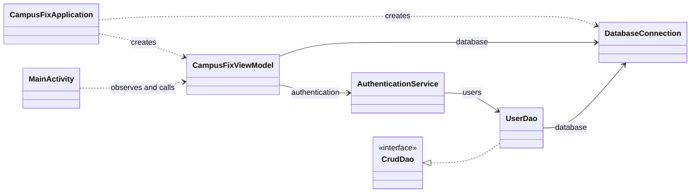

# Android client

The Android client supports sign-in and sign-out for regular and administrator
accounts.

## Changesets

### Foundation

The Android client checks its connection to PostgreSQL when the user taps
**Check database connection**. It reads the connection settings from a private
`.env` file on the device and queries `SELECT 1` through JDBC.

### Account sign-in

The sign-in form accepts a username and password. After sign-in, the account
screen shows the username and role. Sign-out returns to the form.

## Architecture



- **View.** `MainActivity` reads the form, forwards sign-in, sign-out, and
  connection-check actions to the ViewModel, and renders its screen state.
  The Activity obtains the ViewModel through `ViewModelProvider` and the
  application factory.
- **ViewModel.** `CampusFixViewModel` owns the screen state. Its `state()` method
  exposes `LiveData<State>` for the Activity to observe. The ViewModel publishes
  updates through its private `MutableLiveData`. After rotation, the new Activity
  observes the same ViewModel and receives the current state. The ViewModel
  runs authentication and connection checks on one worker and queues connection
  cleanup there when cleared.
- **Model.** `AuthenticationService` verifies credentials. `UserDao` uses
  parameterized JDBC queries, maps database rows to users and credentials, and
  implements `CrudDao`. `DatabaseConnection` opens and reuses an autocommit
  connection.

## Run locally

Use JDK 17 or newer. In [Android Studio's SDK Manager](https://developer.android.com/studio/intro/update#sdk-manager),
install Android SDK Platform 35, Build Tools 35.0.0, and Platform Tools (`adb`).
For a virtual device, install the Android Emulator and an Android 15 or newer
system image. The build uses SDK Platform 35 regardless of the device image.
Android Studio can open the `android/` directory.

Android Studio configures the SDK path in `android/local.properties`.
For terminal-only setup, set `sdk.dir` there once or use `ANDROID_HOME`.
For example, for the default macOS SDK location, add the following line
with your actual account name.

```properties
sdk.dir=/Users/yourname/Library/Android/sdk
```

Create an emulator in Device Manager or connect a debug device running
Android 9 or newer. Start Docker and create the root `.env` from `.env.example`
if needed. Use the local `jdbc:postgresql://localhost:5432/campusfix` URL.

From the repository root, run the launcher in Bash or Zsh. On Windows,
use Git Bash.

```sh
bash android/run.sh
```

The launcher reuses a connected device or starts the only configured emulator.
If you have several emulator profiles, start the one you want first or set
`campusfix.avd` to its name in `android/local.properties`.

Each run starts or reuses PostgreSQL and applies `database/002-accounts.sql`.
The migration preserves existing accounts. The launcher installs the app,
forwards the database port, and replaces the app's private connection settings
before opening it. A failed step returns you to your terminal. Emulator startup
output goes to `android/build/emulator.log`.

| Username | Password | Role |
| --- | --- | --- |
| `alice` | `alice-demo` | Regular |
| `bob` | `bob-demo` | Regular |
| `admin` | `admin-demo` | Administrator |

These sample accounts are for local development databases. Sign in to confirm
the username and role, rotate the device to verify the account stays visible,
and tap **Sign out** to return to the form. Use **Check database connection**
on the sign-in screen to verify PostgreSQL access.

The debug build keeps credentials out of the APK and Git. Use this client with
a trusted local development database. An established connection is not recovered
after a network failure. Restart the app to reconnect.
