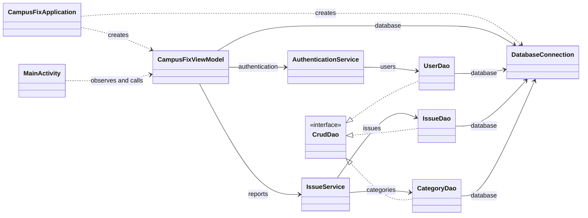

# Android client

The Android client lets regular users submit maintenance reports and review
their own reports. They can edit or cancel a report while it is open.
Administrators can review reports from all users.

## Changesets

### Foundation

The Android client checks its connection to PostgreSQL when the user taps
**Check database connection**. It reads the connection settings from a private
`.env` file on the device and queries `SELECT 1` through JDBC.

### Account sign-in

The sign-in form accepts a username and password. After sign-in, the account
screen shows the username and role. Sign-out returns to the form.

### Submit and list maintenance reports

Regular users submit a title, location, category, and description. New reports
start in `OPEN`. The ViewModel loads active categories for the report form and
publishes the report list for the signed-in account. **Refresh** loads changes
from other sessions.

### Edit and cancel open reports

Regular users can edit or cancel their own open reports. **Edit report** loads
the report into the form. **Discard edit** returns to a blank form. Cancelling
a report keeps it visible with status `CANCELLED`.

`IssueService` validates edited fields and checks the account role. The
update statements check the reporter and current status in PostgreSQL, so
changes from a stale screen are rejected after the report is cancelled.

## Architecture



- **View.** `MainActivity` reads the forms, forwards actions, and renders the
  ViewModel's state. The Activity keeps the draft and its report ID across
  rotation and clears them after saving, cancelling that report, or signing out. It obtains the
  ViewModel through `ViewModelProvider` and the application factory.
- **ViewModel.** `CampusFixViewModel` owns the account, reports, category options,
  and operation status. Its `state()` method exposes `LiveData<State>` for the
  Activity to observe. Updates go through a private `MutableLiveData`. The same
  ViewModel serves the recreated Activity after rotation. One worker runs
  database operations and closes the connection when the ViewModel is cleared.
- **Model.** `AuthenticationService` verifies credentials, and `IssueService`
  validates report changes and selects reports by role. The DAOs implement
  `CrudDao` with parameterized JDBC queries. `DatabaseConnection` opens and
  reuses an autocommit connection.

## Run locally

Use JDK 17 or newer. In [Android Studio's SDK Manager](https://developer.android.com/studio/intro/update#sdk-manager),
install Android SDK Platform 35, Build Tools 35.0.0, and Platform Tools (`adb`).
For a virtual device, install the Android Emulator and an Android 15 or newer
system image. The build uses SDK Platform 35 regardless of the device image.
Android Studio can open the `android/` directory.

Android Studio configures the SDK path in `android/local.properties`.
For terminal-only setup, set `sdk.dir` there once or use `ANDROID_HOME`.
For example, for the default macOS SDK location, add the following line
with your actual account name.

```properties
sdk.dir=/Users/yourname/Library/Android/sdk
```

Create an emulator in Device Manager or connect a debug device running
Android 9 or newer. Start Docker and create the root `.env` from `.env.example`
if needed. Use the local `jdbc:postgresql://localhost:5432/campusfix` URL.

From the repository root, run the launcher in Bash or Zsh. On Windows,
use Git Bash.

```sh
bash android/run.sh
```

The launcher reuses a connected device or starts the only configured emulator.
If you have several emulator profiles, start the one you want first or set
`campusfix.avd` to its name in `android/local.properties`.

Each run starts or reuses PostgreSQL and applies the migrations through
`database/005-report-resolution.sql`.
The scripts preserve existing accounts and reports. The launcher installs the
app, forwards the database port, and replaces the app's private connection
settings before opening it. A failed step returns you to your terminal.
Emulator startup output goes to `android/build/emulator.log`.

| Username | Password | Role |
| --- | --- | --- |
| `alice` | `alice-demo` | Regular |
| `bob` | `bob-demo` | Regular |
| `admin` | `admin-demo` | Administrator |

These sample accounts are for local development databases.

## Verification

Submit a report as `alice`. Open it with **Edit report**, change the title, and
rotate the device. Check that the edit still targets the same report, then
save and cancel it. Confirm that the list shows `CANCELLED`. Sign in as `bob`
to confirm the report is absent, then as `admin` to find it under **All reports**.
Use **Check database connection** on the sign-in screen to verify PostgreSQL
access.

The debug build keeps credentials out of the APK and Git. Use this client with
a trusted local development database. An established connection is not recovered
after a network failure. Restart the app to reconnect.
