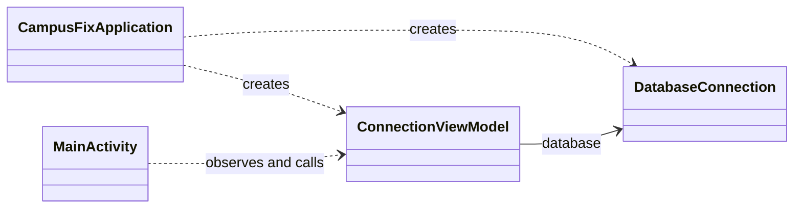

# Android client

## Changesets

### Foundation

The Android client checks its connection to PostgreSQL when the user taps
**Check database connection**. It reads the connection settings from a private
`.env` file on the device and queries `SELECT 1` through JDBC.

## Architecture



The Activity renders the XML layout and observes screen state through LiveData.
The ViewModel runs the check on one worker and keeps its state across screen
rotation. The Model opens and reuses an autocommit connection. When the
ViewModel is cleared, it queues connection cleanup on the same worker.

## Run locally

Use JDK 17 or newer. In [Android Studio's SDK Manager](https://developer.android.com/studio/intro/update#sdk-manager),
install Android SDK Platform 35, Build Tools 35.0.0, and Platform Tools (`adb`).
For a virtual device, install the Android Emulator and an Android 15 or newer
system image. The build uses SDK Platform 35 regardless of the device image.
Android Studio can open the `android/` directory.

On macOS with the default SDK location, set these variables in the terminal
where you will run Gradle and `adb`. If you chose another SDK location, use
that path for `ANDROID_HOME`.

```sh
export ANDROID_HOME="$HOME/Library/Android/sdk"
export PATH="$ANDROID_HOME/platform-tools:$PATH"
adb version
```

Create an emulator in Device Manager or connect a debug device running
Android 9 or newer. Start Docker and create the root `.env` from `.env.example`
if needed. Use the local `jdbc:postgresql://localhost:5432/campusfix` URL.

From the repository root, run the launcher in Bash or Zsh. On Windows,
use Git Bash.

```sh
bash android/run.sh
```

The launcher reuses a connected device or starts the only configured emulator.
If you have several emulator profiles, start the one you want first or set
`campusfix.avd` to its name in `android/local.properties`.

Each run starts or reuses PostgreSQL, installs the app, forwards the database
port, and replaces the app's private connection settings before opening it.
You can rerun the same command after changing settings. A failed step returns
you to your terminal. Emulator startup output goes to `android/build/emulator.log`.

Tap **Check database connection**. Expect **Connected to PostgreSQL.** Rotate
the device to confirm the result stays visible.

The debug build keeps credentials out of the APK and Git. Use this client with
a trusted local development database. An established connection is not recovered
after a network failure. Restart the app to reconnect.
