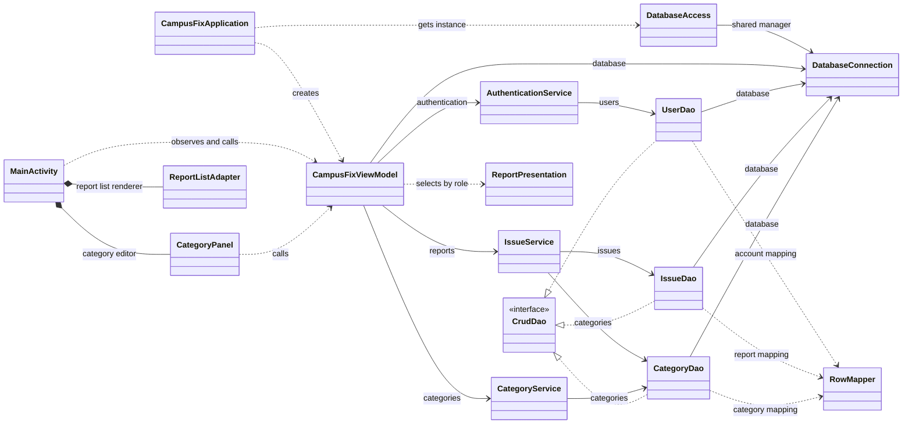

# Android client

The Android client lets regular users submit maintenance reports and review
their own reports. They can edit or cancel a report while it is open.
Administrators can review reports from all users, start work, record resolutions,
and manage report categories.

## Changesets

### Foundation

The Android client checks its connection to PostgreSQL when the user taps
**Check database connection**. It reads the connection settings from a private
`.env` file on the device and queries `SELECT 1` through JDBC.

### Account sign-in

The sign-in form accepts a username and password. After sign-in, the account
screen shows the username and role. Sign-out returns to the form.

### Submit and list maintenance reports

Regular users submit a title, location, category, and description. New reports
start in `OPEN`. The ViewModel loads active categories for the report form and
publishes the report list for the signed-in account. **Refresh** loads changes
from other sessions.

### Edit and cancel open reports

Regular users can edit or cancel their own open reports. **Edit report** loads
the report into the form. **Discard edit** returns to a blank form. Cancelling
a report keeps it visible with status `CANCELLED`.

`IssueService` validates edited fields and checks the account role. The
update statements check the reporter and current status in PostgreSQL, so
changes from a stale screen are rejected after the report is cancelled.

### Start work and resolve reports

Administrators move an `OPEN` report to `IN_PROGRESS` with **Start work**.
On a report in progress, **Resolve report** opens the resolution form. A
nonblank note of up to 2,000 characters is required to mark it `RESOLVED`.
The note appears on the report for the reporter and administrators.

`IssueService` validates the role and note. The Model checks the current
status in the same database statement that advances it. Resolution saves
the new status and note together.

### Manage report categories

Administrators open **Categories** to add a category, rename it, deactivate it,
or reactivate it. The ViewModel publishes the current section, category list,
and operation status. The Activity renders that state, and `CategoryService`
checks permission and validates changes before the DAO writes them.

Report forms offer active categories. Existing reports keep their category ID
and display the current category name even after deactivation.

### Share database access using Singleton

A new Activity can create a new ViewModel in the same app process. The
Singleton lets those ViewModels reuse one connection manager and one worker.
The worker serializes database operations across ViewModels so they can share
the PostgreSQL session safely.

`CampusFixApplication` obtains the single `DatabaseAccess` instance and
passes each ViewModel the worker and a function to get the shared connection
manager. The first request loads the app's private `.env`. When a ViewModel
is cleared, it queues connection cleanup on the same worker. The next
database operation can reopen the connection through the same manager.

### Run report changes using Command

The ViewModel packages each report change as a `ReportCommand`. When an
administrator taps **Resolve report**, the Activity sends the report ID and
note to the ViewModel. The command holds those values, and the ViewModel
captures the current user before queueing the command. The worker calls
`IssueService.resolve` with that user and those values.

Submission, editing, cancellation, starting work, and resolution use
`executeReportCommand` for worker scheduling and error handling. Each
action supplies its own messages and the state update to apply after a
successful write. For example, resolution records the resolved report ID so
the Activity knows which note draft to clear. A validation error leaves the
draft available to edit.

The ViewModel publishes the result through `LiveData` for the current
sign-in session. It reports a successful write even if the list refresh
fails. A change to scheduling or completion handling applies across all
five actions.

### Adapt report rows for the Android list

`ReportListAdapter` turns the ViewModel's `ReportDisplay` records into rows
using `report_row.xml`. It formats each report's title, details, and note,
and binds row actions to that report's data. The Activity supplies the
callbacks that open forms, confirm cancellation, or call the ViewModel.

The layout and report data meet in one class. Changes to row formatting
stay in the View layer. When only the busy state changes, the adapter
updates the action buttons in place. It rebuilds the rows when their
display data changes.

### Give the report form explicit states

The Activity keeps the draft values and the current form state. Choosing
**Edit report** creates an `EditingReport` for the selected ID. The ViewModel
delegates saving to that state, which runs an update. `NewReport` runs a
submission. A successful save, discard, sign-out, or cancellation of the
report being edited resets the form. A validation error preserves the draft.

- **Correctness.** `EditingReport` keeps a fixed report ID. The Activity saves
  it with the draft and reconstructs the state after rotation, so **Save
  changes** still targets the same report. Cancelling a different report
  leaves the edit intact.
- **Readability.** The same named state drives the form heading and save
  operation. Each state keeps its command and operation messages together.
- **Flexibility.** Another form mode can implement `ReportFormState` and
  reuse the ViewModel's command scheduling, validation feedback, and list
  refresh. The Activity handles how to enter, display, and restore that mode.

### Choose the report presentation by role

The ViewModel selects a `ReportPresentation` strategy for the signed-in
role and publishes its account heading, form visibility, and row actions
through `LiveData`. Regular users can submit reports and manage their open
reports. Administrators can start open reports and resolve reports in
progress.

- **Correctness.** Each strategy keeps the role's form setting and action
  flags consistent. The Model filters visible reports and checks permission
  and status before applying changes.
- **Readability.** The ViewModel handles loading and refresh. Each role's
  strategy groups its status checks, and both share the conversion to
  `ReportDisplay`.
- **Flexibility.** A change to a role's report controls stays in its strategy.
  The Activity and list adapter continue rendering the same state.

### Share result-set handling with Template Method

The DAOs prepare SQL and bind parameters. `RowMapper` executes the
prepared statement and defines how to read a single result or a list.
Each mapper implements `mapRow()` to turn the current row into an
account, category, issue, or report summary.

- **Correctness.** `queryOne()` returns an empty `Optional` for a missing row.
  `queryAll()` preserves query order and returns an empty list for an empty
  result. Both close the result set when mapping finishes or raises an error.
- **Readability.** Each DAO keeps its query, parameters, and column mapping
  together. Cursor traversal and result-set cleanup live in one class.
- **Flexibility.** A new mapper can reuse the same query steps and implement
  its own column conversion. The report summary mapper reuses the issue
  mapper and adds the reporter and category names from the join.

## Architecture



- **View.** `MainActivity` reads the forms, forwards actions, and renders the
  ViewModel's state. It preserves unfinished report edits, resolution notes,
  and category drafts with their IDs across rotation. A successful save or
  sign-out clears the corresponding draft. `ViewModelProvider` supplies the
  ViewModel through the application factory.
- **ViewModel.** `CampusFixViewModel` owns the account, reports, category lists,
  current section, and operation status. Its `state()` method exposes
  `LiveData<State>` for the Activity to observe. Updates go through a private
  `MutableLiveData`. The same ViewModel serves the recreated Activity after
  rotation. The application supplies the worker that runs database operations
  and closes the connection when a ViewModel is cleared.
- **Model.** `AuthenticationService` verifies credentials, and `IssueService`
  validates report changes and selects reports by role. `CategoryService`
  restricts category management to administrators. The DAOs implement
  `CrudDao` with parameterized JDBC queries. `DatabaseConnection` opens and
  reuses an autocommit connection.

## Run locally

Use JDK 17 or newer. In [Android Studio's SDK Manager](https://developer.android.com/studio/intro/update#sdk-manager),
install Android SDK Platform 35, Build Tools 35.0.0, and Platform Tools (`adb`).
For a virtual device, install the Android Emulator and an Android 15 or newer
system image. The build uses SDK Platform 35 regardless of the device image.
Android Studio can open the `android/` directory.

Android Studio configures the SDK path in `android/local.properties`.
For terminal-only setup, set `sdk.dir` there once or use `ANDROID_HOME`.
For example, for the default macOS SDK location, add the following line
with your actual account name.

```properties
sdk.dir=/Users/yourname/Library/Android/sdk
```

Create an emulator in Device Manager or connect a debug device running
Android 9 or newer. Start Docker and create the root `.env` from `.env.example`
if needed. Use the local `jdbc:postgresql://localhost:5432/campusfix` URL.

From the repository root, run the launcher in Bash or Zsh. On Windows,
use Git Bash.

```sh
bash android/run.sh
```

The launcher reuses a connected device or starts the only configured emulator.
If you have several emulator profiles, start the one you want first or set
`campusfix.avd` to its name in `android/local.properties`.

Each run starts or reuses PostgreSQL and applies the migrations through
`database/005-report-resolution.sql`.
The scripts preserve existing accounts, reports, and categories. The launcher
installs the app, forwards the database port, and replaces the app's private connection
settings before opening it. A failed step returns you to your terminal.
Emulator startup output goes to `android/build/emulator.log`.

| Username | Password | Role |
| --- | --- | --- |
| `alice` | `alice-demo` | Regular |
| `bob` | `bob-demo` | Regular |
| `admin` | `admin-demo` | Administrator |

These sample accounts are for local development databases. As `admin`, tap
**Categories** to open the editor and **Reports** to return to the report list.
**Refresh** reloads the current list.

## Verification

Submit a report as `alice`. Open it with **Edit report**, change the title, and
rotate the device. Check that the edit still targets the same report, then
save and cancel it. Confirm that the list shows `CANCELLED`. Sign in as `bob`
to confirm the report is absent, then as `admin` to find it under **All reports**.
Use **Check database connection** on the sign-in screen to verify PostgreSQL
access.

Submit another report as `alice`, then sign in as `admin` and tap **Start work**.
Open **Resolve report**, enter a note, and rotate the device to verify that
the note and report ID survive. Save the note and sign back in as the reporter
to confirm the report shows `RESOLVED` and displays the note.

As `admin`, add a category and rename one that has a report. Deactivate that
category and check the existing report still displays its new name. As `alice`,
check the category picker omits it. Reactivate it as `admin`, then sign in as
`alice` again to verify it is available for new reports.

The debug build keeps credentials out of the APK and Git. Use this client with
a trusted local development database. An established connection is not recovered
after a network failure. Restart the app to reconnect.
