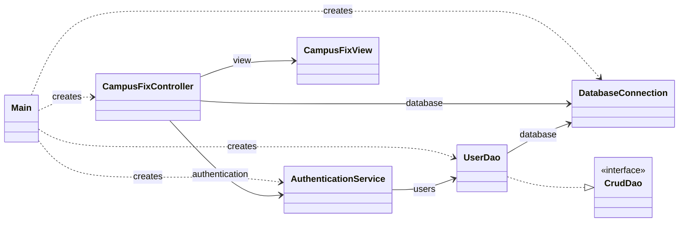

# Java desktop client

The Swing client supports sign-in and sign-out for regular and administrator accounts.

## Changesets

### Foundation

The first changeset establishes the Java 17 build, the Swing MVC structure,
and local PostgreSQL configuration. It adds a JDBC connection check to verify
that the application can load its settings, connect, and run a query.

### Account sign-in

Java can sign in as a regular user or an administrator and displays a matching
account screen. The `UserDao` uses a parameterized JDBC query and maps the row
to a `User` and its credentials. `AuthenticationService` checks the password
and returns the authenticated `User` to the Controller. Sign-out clears the
user from the Controller and returns to the sign-in screen.

`UserDao` implements the shared `CrudDao` interface for creating, reading,
updating, and deleting accounts. The username lookup used for sign-in is specific
to `UserDao`.

## Architecture

The `java/model` module contains database access without a UI dependency.
The `java/desktop` module depends on it and contains the application entry point,
Controller, and View.



The dashed arrows show classes `Main` instantiates at startup. The solid arrows
show references held in fields. The Controller creates its View and registers
`Runnable` callbacks for sign-in, sign-out, connection checks, and window close.
The View renders the screen and passes events through those callbacks.

| Class | Responsibility |
| --- | --- |
| `Main` | Read `.env` connection settings, construct the Model objects, and start the Controller on Swing's event thread. |
| `CampusFixController` | Create the View, keep the signed-in user in memory, and run database operations on one worker. |
| `CampusFixView` | Render sign-in and account screens and expose events through callbacks. |
| `AuthenticationService` | Authenticate the submitted credentials and return the user on success. |
| `UserDao` | Implement account CRUD and username lookup with parameterized SQL. |
| `DatabaseConnection` | Open, reuse, check, and close the JDBC connection. |

Account passwords are stored as a 16-byte salt and a 32-byte PBKDF2-HMAC-SHA256
hash derived with 600,000 iterations. The account roles are distinct from the
PostgreSQL login role used to connect to the database.

## Start PostgreSQL

From the repository root, with Docker running:

```sh
cp .env.example .env
```

Edit `.env` to set the application and setup passwords, then start PostgreSQL:

```sh
docker compose up -d --wait
```

Compose reads `.env` and passes the configured credentials to PostgreSQL. The
initialization script uses psql's `\getenv` command to read the application role
and password. Identifiers and password literals are quoted through psql variables.
It creates the `campusfix` and `campusfix_test` databases, owned by the configured
application role. The separate setup superuser initializes the server.

Initialization runs only when the Compose volume is empty. Changing `.env` does
not update an existing role or password; update existing database credentials
separately. Do not delete a data volume to apply configuration changes.

For an existing PostgreSQL server, configure `.env` with its connection URLs and
an already provisioned application role and databases.

## Initialize accounts

From the repository root, apply the account schema as the application database
role. The script can be rerun and preserves existing accounts.

```sh
docker compose exec -T database sh -c \
  'psql -v ON_ERROR_STOP=1 -U "$CAMPUSFIX_DB_USER" -d campusfix' < database/002-accounts.sql
```

For integration tests, also apply it to the separate test database:

```sh
docker compose exec -T database sh -c \
  'psql -v ON_ERROR_STOP=1 -U "$CAMPUSFIX_DB_USER" -d campusfix_test' < database/002-accounts.sql
```

If you use an existing PostgreSQL server, run `database/002-accounts.sql` on the
application and test databases with `psql` as the configured application role.

| Username | Password | Role |
| --- | --- | --- |
| `alice` | `alice-demo` | Regular |
| `bob` | `bob-demo` | Regular |
| `admin` | `admin-demo` | Administrator |

These sample accounts are for local development databases.

## Build and run

From the repository root:

```sh
cd java
./gradlew test
./gradlew :model:integrationTest
./gradlew :desktop:run
```

On Windows, use `gradlew.bat` instead of `./gradlew`.

Sign in with a sample account. The window shows the account role and username.
Use **Sign out** to return to sign-in. **Check database connection** is available
on the sign-in screen. Closing the window shuts down the worker and connection.

## Configuration

The application and integration tests read `.env` from their working directory.
Gradle's `run` and `integrationTest` tasks set that directory to the repository
root. Launch installed binaries from a directory containing `.env`.

| Setting | Purpose |
| --- | --- |
| `CAMPUSFIX_DB_URL` | Application JDBC URL. |
| `CAMPUSFIX_TEST_DB_URL` | Integration-test JDBC URL; the database name must end in `_test`. |
| `CAMPUSFIX_DB_USER` | Application database role, also used by integration tests. |
| `CAMPUSFIX_DB_PASSWORD` | Password for the application database role. |
| `CAMPUSFIX_POSTGRES_PASSWORD` | Setup superuser password, used only by Compose. |

The `.env` file is required. Missing or empty required settings stop startup
instead of falling back to credentials in code. Process environment variables
override values from the file. Ordinary unit tests do not need a root `.env`
or PostgreSQL.

The client uses [dotenv-java](https://github.com/cdimascio/dotenv-java) to load
configuration. Use one `KEY=value` assignment per line, with unquoted values or
double quotes where needed. Keep values self-contained rather than referencing
other settings, so Compose and the client use the same configuration.

Keep `.env` and `.env.*` files out of Git. Only `.env.example`, containing
placeholders, is intended to be committed.

```sh
docker compose stop
```

This stops the local database without deleting its volume. An alternative
port can be configured in `compose.yaml`; update both JDBC URLs accordingly.

## Verification

- Run `test` to verify password checking against a reference hash and cover
  connection settings and failures.
- Run `:model:integrationTest` to check JDBC connection handling, account CRUD,
  and PostgreSQL-backed sign-in with both roles and invalid credentials.
- Sign in as `alice`, sign out, and sign in as `admin`. Verify each role and try
  an incorrect password. Sign-in and connection checks run off the UI thread.

## Limitations

One background worker serializes connection access. The driver bounds connection
and socket waits. A failed initial connection can be checked again, but an
established connection is not recovered after a network failure; restart the
application in that case. There are no automatic write retries, connection pools,
or explicit transactions.
