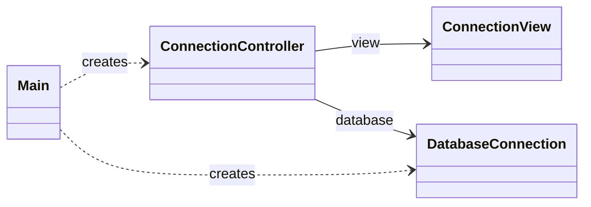

# Java desktop client

The Swing client verifies PostgreSQL connectivity using a UI-independent Model.

## Changesets

### Foundation

The first changeset establishes the Java 17 build, the Swing MVC structure,
and local PostgreSQL configuration. The desktop window runs a connection check
through JDBC and displays the result. The check verifies that the application
can load its settings, connect to the database, and run a query.

## Architecture

The `java/model` module contains database access without a UI dependency.
The `java/desktop` module depends on it and contains the application entry point,
Controller, and View.



The dashed arrows show classes `Main` instantiates at startup. The solid arrows
show references the Controller keeps in fields. The Controller creates its View
and supplies `Runnable` callbacks for check and close events. The View invokes
those callbacks through the `Runnable` interface.

| Class | Responsibility |
| --- | --- |
| `Main` | Read `.env` connection settings, supply the Model dependency, start the Controller on Swing's event thread. |
| `ConnectionController` | Create the View, bind events, run Model calls on one worker, render outcomes, and coordinate shutdown. |
| `ConnectionView` | Construct Swing widgets, display strings, and expose check/close events through callbacks. |
| `DatabaseConnection` | Open and reuse a JDBC connection, execute `SELECT 1`, close query resources, and close the connection. |

The Model currently contains connection management and the connectivity query.
The connection object is created by the application bootstrap and supplied to
the Controller.

## Start PostgreSQL

From the repository root, with Docker running:

```sh
cp .env.example .env
```

Edit `.env` to set the application and setup passwords, then start PostgreSQL:

```sh
docker compose up -d --wait
```

Compose reads `.env` and passes the configured credentials to PostgreSQL. The
initialization script uses psql's `\getenv` command to read the application role
and password. Identifiers and password literals are quoted through psql variables.
It creates the `campusfix` and `campusfix_test` databases, owned by the configured
application role, without creating application tables. The separate setup
superuser is only used to initialize the server.

Initialization runs only when the Compose volume is empty. Changing `.env` does
not update an existing role or password; update existing database credentials
separately. Do not delete a data volume to apply configuration changes.

For an existing PostgreSQL server, configure `.env` with its connection URLs and
an already provisioned application role and databases.

## Build and run

From the repository root:

```sh
cd java
./gradlew test
./gradlew :model:integrationTest
./gradlew :desktop:run
```

On Windows, use `gradlew.bat` instead of `./gradlew`.

Click **Check database connection**. The button is disabled while the worker
executes the query, and the screen should show **Connected to PostgreSQL.**
Closing the window queues connection cleanup on the same worker and shuts it down.

## Configuration

The application and integration tests read `.env` from their working directory.
Gradle's `run` and `integrationTest` tasks set that directory to the repository
root. Launch installed binaries from a directory containing `.env`.

| Setting | Purpose |
| --- | --- |
| `CAMPUSFIX_DB_URL` | Application JDBC URL. |
| `CAMPUSFIX_TEST_DB_URL` | Integration-test JDBC URL; the database name must end in `_test`. |
| `CAMPUSFIX_DB_USER` | Application database role, also used by integration tests. |
| `CAMPUSFIX_DB_PASSWORD` | Password for the application database role. |
| `CAMPUSFIX_POSTGRES_PASSWORD` | Setup superuser password, used only by Compose. |

The `.env` file is required. Missing or empty required settings stop startup
instead of falling back to credentials in code. Process environment variables
override values from the file. Ordinary unit tests do not need a root `.env`
or PostgreSQL.

The client uses [dotenv-java](https://github.com/cdimascio/dotenv-java) to load
configuration. Use one `KEY=value` assignment per line, with unquoted values or
double quotes where needed. Keep values self-contained rather than referencing
other settings, so Compose and the client use the same configuration.

Keep `.env` and `.env.*` files out of Git. Only `.env.example`, containing
placeholders, is intended to be committed.

```sh
docker compose stop
```

This stops the local database without deleting its volume. An alternative
port can be configured in `compose.yaml`; update both JDBC URLs accordingly.

## Verification

- Run `test`: required connection settings and connection failures are checked.
- Run `:model:integrationTest`: it executes a real query, verifies connection reuse
  and autocommit, and verifies that closing the Model closes JDBC resources.
- Try an incorrect password: the screen reports failure and enables another
  check. Driver details are logged to the terminal rather than displayed.
- During a slow/unavailable connection, the window should remain responsive.

## Limitations

One background worker serializes connection access. The driver bounds connection
and socket waits. A failed initial connection can be checked again, but an
established connection is not recovered after a network failure; restart the
application in that case. There are no automatic write retries, connection pools,
or explicit transactions.
