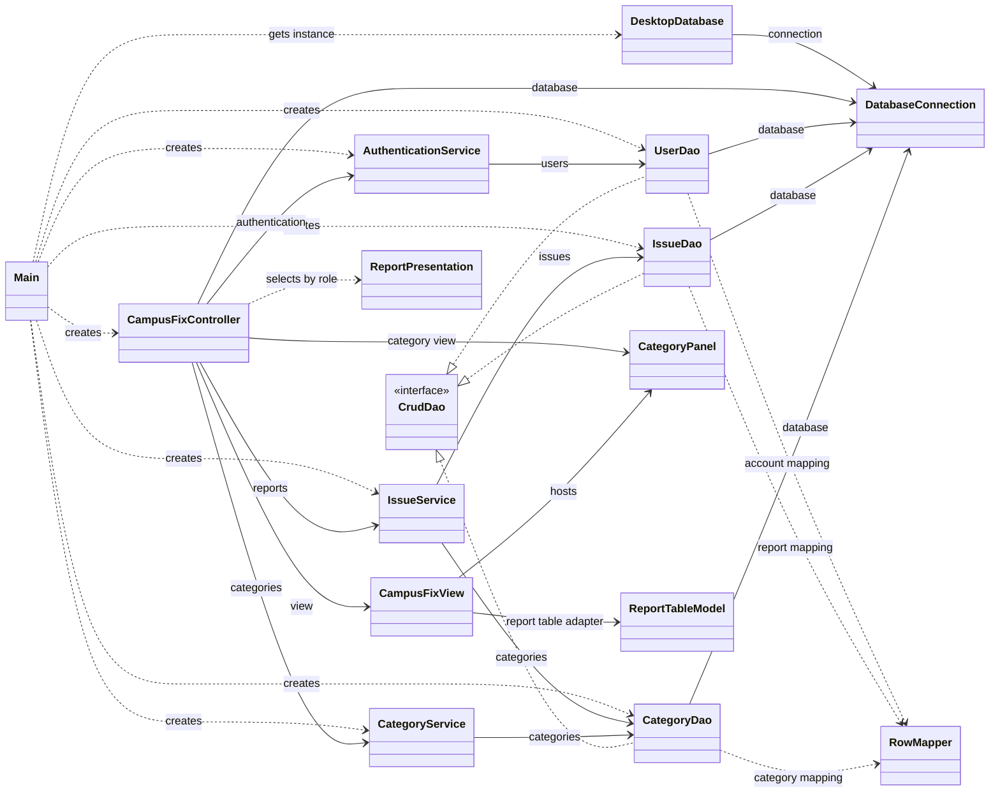

# Java desktop client

The Swing client lets regular users submit maintenance reports and review their
own reports. They can edit or cancel a report while it is open. Administrators
can review reports from all users, start work, record resolutions, and manage
categories.

## Changesets

### Foundation

The first changeset establishes the Java 17 build, the Swing MVC structure,
and local PostgreSQL configuration. It adds a JDBC connection check to verify
that the application can load its settings, connect, and run a query.

### Account sign-in

Java can sign in as a regular user or an administrator and displays a matching
account screen. The `UserDao` uses a parameterized JDBC query and maps the row
to a `User` and its credentials. `AuthenticationService` checks the password
and returns the authenticated `User` to the Controller. Sign-out clears the
user from the Controller and returns to the sign-in screen.

`UserDao` implements the shared `CrudDao` interface for creating, reading,
updating, and deleting accounts. The username lookup used for sign-in is specific
to `UserDao`.

### Submit and list maintenance reports

Regular users submit a title, location, category, and description. New reports
start in `OPEN`. `IssueService` applies the account role when submitting or
listing reports. Each list shows the reporter and category name.

### Edit and cancel open reports

Regular users can edit or cancel their own open reports. Editing uses the same
field validation as submission and requires an active category. Cancellation
sets the report to `CANCELLED` and keeps it visible in report lists.

`IssueService` checks the account role. The update statements check the
reporter and current status in PostgreSQL so an action from an older screen
cannot edit or cancel a report after its status changes.

### Start work and resolve reports

Administrators move a report from `OPEN` to `IN_PROGRESS` with **Start work**.
Once the report is in progress, **Resolve report** moves it to `RESOLVED` with
a required resolution note of up to 2,000 characters. The reporter can read
the note from the report list.

`IssueService` checks the administrator role and validates the note. Each DAO
update checks the report's current status in the same statement that writes
the new status. Resolution saves the status and note together.

### Manage report categories

Administrators can list, add, rename, deactivate, and reactivate categories.
The Model validates category names and rejects duplicates. Active categories
are available in the report form. Existing reports keep their category when it
is renamed or deactivated.

The maintenance-report migration seeds the default categories only when the
category table is empty. Rerunning the launcher preserves renames and inactive
categories.

### Share the desktop database using Singleton

The Singleton gives the desktop process one owner for its database
connection. If another startup component requests database access, it
reuses the configured manager and avoids opening a separate PostgreSQL
session that would need to be closed separately.

`DesktopDatabase` has a private constructor and a synchronized `getInstance()`
method. The first call loads the database settings from `.env` and creates the
connection manager. Later calls return the same instance. The manager opens
the JDBC connection on the first database operation.

`Main` passes the manager to the Controller and DAOs. They receive their
database dependency explicitly, so integration tests can supply a manager
configured for `campusfix_test`. The Controller's worker still owns JDBC
access and closes the connection when the window closes.

### Run report changes using Command

A `ReportCommand` packages a report change and the values it needs so the
Controller can queue it for later execution. When an administrator chooses
**Resolve report**, the Controller captures the signed-in user, report ID,
and note on Swing's event thread. The worker runs the command, which calls
`IssueService.resolve` with those captured values. The Model still validates
the note and checks whether the report can be resolved.

Submission, editing, cancellation, starting work, and resolution all use
`executeReportCommand`. It shows progress, queues the work, and handles
completion on Swing's event thread. It refreshes the list after a successful
change, shows validation or database errors, and applies feedback only to
the account that requested the change. Each action supplies its own messages
and any cleanup it needs. For example, resolution clears the draft note after
the write succeeds, so a validation error leaves the note available to edit.

This keeps worker scheduling and error handling in one place. Changes to
that flow apply to every report action, while each action keeps its own
inputs and completion behavior.

### Adapt report rows for the Swing table

`JTable` expects a `TableModel` that answers questions about row counts,
column names, and individual cells. The Controller supplies a list of
`ReportRow` values. `ReportTableModel` adapts that list to Swing's interface,
so a request for the title cell reads the title from the corresponding row.

The table and the report details now read from the same snapshot of report
rows. Refreshing replaces the snapshot and sends Swing one table update.
The View restores the selection by report ID, so the same report stays
selected when a newer report moves it down the list. The adapter stays in
the View layer and works with the presentation data supplied by the Controller.

### Give the report form explicit states

The Controller uses the **State** pattern to decide what the form does on
save. `NewReport` queues a submission. Choosing **Edit report** switches to
`EditingReport`, which queues an update. A successful save, discard, sign-out,
or cancellation of the report being edited returns the form to `NewReport`.
A validation error keeps the state and draft available for correction.

- **Correctness.** `EditingReport` requires a report ID when it is created and
  keeps that ID for the life of the edit. Selecting another table row leaves the
  save target intact. The Controller also uses the stored ID to decide whether
  a cancellation should clear the draft.
- **Readability.** The state names make the form mode explicit. The Controller
  calls `reportForm.save(...)`, and each state keeps its Model operation next
  to its progress and completion messages.
- **Flexibility.** A new form mode can implement `ReportFormState` with its own
  save behavior. The Controller defines when to enter and leave that state,
  and the state can reuse the existing command scheduling and error handling.

### Choose the report presentation by role

The Controller uses the **Strategy** pattern to prepare the report screen.
It selects a `ReportPresentation` for the signed-in role. The regular
strategy shows the submission form and enables editing or cancellation for
open reports. The administrator strategy offers **Start work** for open
reports and **Resolve report** for reports in progress.

- **Correctness.** One strategy determines the report form and action flags
  for each role. The Model still decides which reports the user can see and
  checks permissions and status when a report change is requested.
- **Readability.** The Controller handles loading and refresh. The strategy
  keeps each role's status checks together and uses the same row conversion
  for both roles.
- **Flexibility.** A change to a role's report controls belongs in its
  strategy. The worker, refresh flow, and Swing table can use the same
  interfaces as those rules evolve.

### Share result-set handling with Template Method

A DAO prepares its SQL and binds the parameters. `RowMapper` defines the
fixed steps for queries that return rows. `queryOne()` reads the first row
into an `Optional`, and `queryAll()` walks the result set in query order.
Both call the mapper's `mapRow()` method to convert the current row and
close the result set when the query finishes.

- **Correctness.** The templates handle empty results consistently and close
  the result set even if a mapper throws. Each DAO closes its prepared
  statements through try-with-resources.
- **Readability.** SQL and parameters stay visible in the DAO alongside the
  code that maps its columns. The cursor traversal lives in one class.
- **Flexibility.** A new mapper supplies only its column conversion. The
  report-summary mapper reuses the issue mapper and adds the reporter and
  category names from the join.

## Architecture

The `java/model` module contains database access without a UI dependency.
The `java/desktop` module depends on it and contains the application entry point,
Controller, and View.



`Main` gets the shared `DatabaseConnection` from `DesktopDatabase` and passes
it to the Controller and the three DAOs. The Controller creates the Views and
binds `Runnable` callbacks for account, report, and category actions. The Views
render data from the Controller and forward UI events through those callbacks.

| Class | Responsibility |
| --- | --- |
| `Main` | Get the connection manager, construct the Model objects, and start the Controller on Swing's event thread. |
| `DesktopDatabase` | Load `.env` and provide one connection manager per desktop process. |
| `CampusFixController` | Create the View, keep the signed-in user in memory, and run database operations on one worker. |
| `CampusFixView` | Render the sign-in form, report form, and report list. |
| `ReportTableModel` | Expose the report rows through Swing's table interface. |
| `AuthenticationService` | Authenticate the submitted credentials and return the user on success. |
| `UserDao` | Implement account CRUD and username lookup with parameterized SQL. |
| `IssueService` | Validate report changes, check permissions, and select the list for the signed-in role. |
| `IssueDao` | Persist issues and query their reporter and category names. |
| `CategoryPanel` | Render the category list and forms for the administrator. |
| `CategoryService` | Check the administrator role, validate names, and manage categories. |
| `CategoryDao` | Persist categories and list all or active categories. |
| `DatabaseConnection` | Open, reuse, check, and close the JDBC connection. |

Account passwords are stored as a 16-byte salt and a 32-byte PBKDF2-HMAC-SHA256
hash derived with 600,000 iterations. The account roles are distinct from the
PostgreSQL login role used to connect to the database.

## Run locally

Use JDK 17 or newer and start Docker. On first setup, copy `.env.example`
to `.env` in the repository root and set the application and setup passwords.
From the repository root, run the launcher in Bash or Zsh. On Windows,
use Git Bash.

```sh
bash java/run.sh
```

The launcher starts PostgreSQL, applies the application migrations in order,
and opens the desktop client. You can rerun the same command after changes.

Compose reads `.env` and passes the configured credentials to PostgreSQL. The
initialization script uses psql's `\getenv` command to read the application role
and password. Identifiers and password literals are quoted through psql variables.
It creates the `campusfix` and `campusfix_test` databases, owned by the configured
application role. The separate setup superuser initializes the server.

Initialization runs only when the Compose volume is empty. Changing `.env` does
not update an existing role or password; update existing database credentials
separately. Do not delete a data volume to apply configuration changes.

For an existing PostgreSQL server, configure `.env` with its connection URLs and
an already provisioned application role and databases.

## Apply database migrations

The launcher runs the migrations on `campusfix`. `002-accounts.sql` creates and
seeds the accounts. `003-maintenance-reports.sql` creates the issue
and category tables and adds the initial categories. `004-report-cancellation.sql`
allows reports to be marked `CANCELLED`. `005-report-resolution.sql` adds the
two work statuses and the resolution note. The scripts are safe to rerun.

### Integration test database

From the repository root, start PostgreSQL and apply the same migrations to `campusfix_test`.

```sh
docker compose up -d --wait &&
docker compose exec -T database sh -c \
  'psql -v ON_ERROR_STOP=1 -U "$CAMPUSFIX_DB_USER" -d campusfix_test' \
  < database/002-accounts.sql &&
docker compose exec -T database sh -c \
  'psql -v ON_ERROR_STOP=1 -U "$CAMPUSFIX_DB_USER" -d campusfix_test' \
  < database/003-maintenance-reports.sql &&
docker compose exec -T database sh -c \
  'psql -v ON_ERROR_STOP=1 -U "$CAMPUSFIX_DB_USER" -d campusfix_test' \
  < database/004-report-cancellation.sql &&
docker compose exec -T database sh -c \
  'psql -v ON_ERROR_STOP=1 -U "$CAMPUSFIX_DB_USER" -d campusfix_test' \
  < database/005-report-resolution.sql
```

For an existing PostgreSQL server, apply the SQL files in order using the
configured application role, then run `./java/gradlew -p java :desktop:run`
from the repository root. On Windows, use `java\gradlew.bat` as the wrapper.

## Use the client

| Username | Password | Role |
| --- | --- | --- |
| `alice` | `alice-demo` | Regular |
| `bob` | `bob-demo` | Regular |
| `admin` | `admin-demo` | Administrator |

These sample accounts are for local development databases.

Sign in as `alice` or `bob` to submit a report and see **My reports**. Select
an open report and choose **Edit report** to load it into the form, or choose
**Cancel report** and confirm to mark it `CANCELLED`. Sign in as `admin` to
see **All reports**. Select an open report and choose **Start work**. Add a
resolution note and choose **Resolve report** when work is complete. Use
**Refresh** to load changes made by another session. Closing the window shuts
down the worker and connection.

As an administrator, select **Categories** to manage the list. Choose a row
to rename, deactivate, or reactivate that category. Select **Reports** to
return to the report list.

## Configuration

The application and integration tests read `.env` from their working directory.
Gradle's `run` and `integrationTest` tasks set that directory to the repository
root. Launch installed binaries from a directory containing `.env`.

| Setting | Purpose |
| --- | --- |
| `CAMPUSFIX_DB_URL` | Application JDBC URL. |
| `CAMPUSFIX_TEST_DB_URL` | Integration-test JDBC URL; the database name must end in `_test`. |
| `CAMPUSFIX_DB_USER` | Application database role, also used by integration tests. |
| `CAMPUSFIX_DB_PASSWORD` | Password for the application database role. |
| `CAMPUSFIX_POSTGRES_PASSWORD` | Setup superuser password, used only by Compose. |

The `.env` file is required. Missing or empty required settings stop startup
instead of falling back to credentials in code. Process environment variables
override values from the file. Ordinary unit tests do not need a root `.env`
or PostgreSQL.

The client uses [dotenv-java](https://github.com/cdimascio/dotenv-java) to load
configuration. Use one `KEY=value` assignment per line, with unquoted values or
double quotes where needed. Keep values self-contained rather than referencing
other settings, so Compose and the client use the same configuration.

Keep `.env` and `.env.*` files out of Git. Only `.env.example`, containing
placeholders, is intended to be committed.

```sh
docker compose stop
```

This stops the local database without deleting its volume. An alternative
port can be configured in `compose.yaml`; update both JDBC URLs accordingly.

## Verification

Run the unit tests from the repository root. After migrating the test database,
run the integration tests from the same directory.

```sh
./java/gradlew -p java test
./java/gradlew -p java :model:integrationTest
```

- Run `test` for password checking, report validation, and connection settings.
- Run `:model:integrationTest` for PostgreSQL-backed authentication, account CRUD,
  connection reuse, report visibility by role, active-category checks, and
  permissions for report and category changes.
- Submit and edit a report as `alice`, then cancel it. Confirm that its row
  shows `CANCELLED` and that the edit and cancel actions are disabled.
  Sign in as `bob` to confirm it is absent, then as `admin` to find it under
  **All reports**.
- Submit another report as `alice`. Sign in as `admin` and start work on it. Try
  resolving it with an empty note, then save a valid note. Sign in as `alice` to
  verify the status and note.

- Rename and deactivate a category as `admin`. Verify that an existing report
  shows the new name and that the inactive category is absent from new reports.
  Reactivate it to make it available again.

## Limitations

One background worker serializes connection access. The driver bounds connection
and socket waits. A failed initial connection can be checked again, but an
established connection is not recovered after a network failure; restart the
application in that case. There are no automatic write retries, connection pools,
or explicit transactions.
