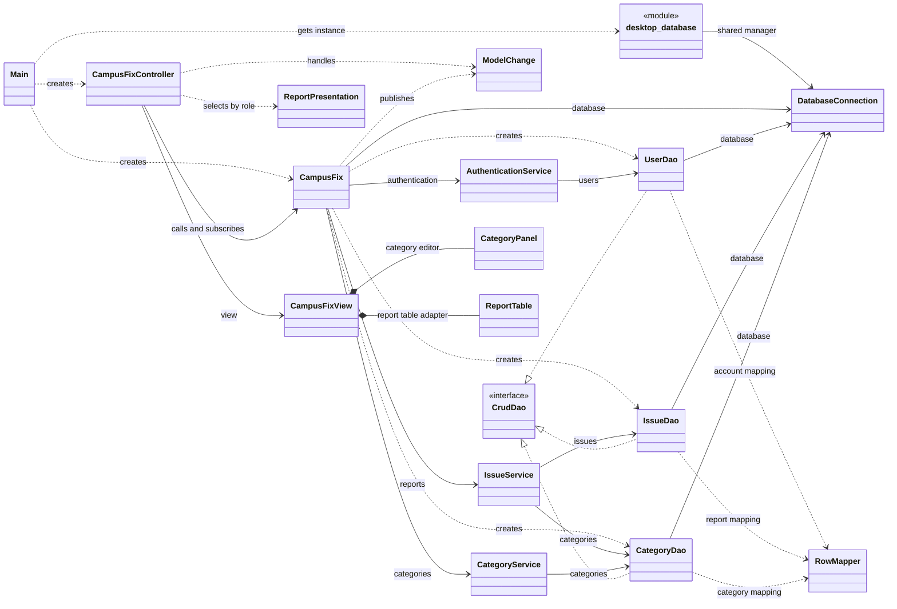

# Python desktop client

The Tkinter client lets regular users submit maintenance reports and review
their own reports. They can edit or cancel a report while it is open.
Administrators can review reports from all users, start work, record resolutions,
and manage report categories.

## Changesets

### Foundation

The Tkinter client checks its connection to PostgreSQL. It reads the root `.env`
with python-dotenv and uses Psycopg to run `SELECT 1`. The window displays the
result and remains responsive while the check runs.

### Account sign-in

The sign-in form accepts a username and password. `UserDao` looks up the username
with a parameterized query and maps the row to a `User` and its credentials.
`AuthenticationService` verifies the password and returns the authenticated `User`
to the Controller. The account screen displays the username and role. Sign-out
clears the user from the Controller and returns to the form.

`UserDao` implements `CrudDao` for creating, reading, updating, and deleting
accounts. Username lookup is specific to `UserDao`.

### Submit and list maintenance reports

Regular users submit a title, location, category, and description. New reports
start in `OPEN`. `IssueService` checks who can submit and selects the report list
for the signed-in role. `IssueDao` and `CategoryDao` implement `CrudDao` and use
parameterized queries to persist reports and categories. The list shows the
reporter and category name alongside each report.

### Edit and cancel open reports

Regular users can edit or cancel their own open reports. Editing uses the same
field validation as submission and requires an active category. Cancellation
sets the report to `CANCELLED` and keeps it visible in report lists.

`IssueService` checks the account role. The update statements check the
reporter and current status in PostgreSQL so an action from an older screen
cannot edit or cancel a report after its status changes.

### Start work and resolve reports

Administrators move a report from `OPEN` to `IN_PROGRESS` with **Start work**.
Once the report is in progress, **Resolve report** moves it to `RESOLVED` with
a required resolution note of up to 2,000 characters. The reporter can read
the note in the report details.

`IssueService` checks the administrator role and validates the note. Each DAO
update checks the report's current status in the same statement that writes
the new status. Resolution saves the status and note together.

### Manage report categories

Administrators can add, rename, deactivate, and reactivate categories.
`CategoryService` checks the administrator role and validates category names.
`CategoryDao` updates the name or active flag by ID. Reports keep their original
category ID and display the current name, including when the category is
inactive. Report forms offer active categories.

### Share the desktop database using Singleton

The Singleton gives the desktop process one place to get its database
connection manager. Repeated startup requests reuse that manager and its
settings, avoiding separate PostgreSQL sessions with separate lifecycles.

`desktop_database.get_instance()` uses a lock so concurrent callers can
initialize the manager only once. The first call reads the root `.env`. The
manager opens the Psycopg connection when the Controller first needs it.

At this stage, the entry point passes the manager to the Controller and
DAOs. Integration tests can supply a manager configured for `campusfix_test`.

### Launch the desktop client

`python/run.sh` creates or reuses the virtual environment, installs the required
packages, starts PostgreSQL, applies the application migrations, and opens the
Tkinter client.

### Run report changes using Command

The Controller uses `functools.partial` to bind the arguments to each report
operation before sending it to the database worker. For **Resolve report**,
the resulting `ReportCommand` holds the signed-in user, report ID, and note
read on the Tkinter event thread. The command later reaches `IssueService`
with those captured values, and the Model applies the report rules.

At this stage, all five report actions use `_execute_report_command()` for
progress, worker scheduling, and completion. Each action supplies its
messages and any cleanup. For example, resolution clears the draft note
after the write succeeds, so a validation error leaves the note available
to edit. Signing out cancels the pending UI callback for that session.

### Adapt report rows for the Tkinter table

`ReportTable` is a `ttk.Treeview` that accepts the `ReportRow` values supplied
by the Controller. It adapts each record to the tuple of cells that Tkinter
expects and uses the report ID as the widget's item ID.

The same adapter translates a selected item back to its `ReportRow`, which
the View uses for details and actions. Refresh restores the selected report
by ID even if a newer report moves it down the list. The column definitions
and row conversion live together in the View layer, so changes to column
order and widths stay local to the adapter.

### Give the report form explicit states

The Controller uses the **State** pattern to decide what the form does on
save. `NewReport` prepares a submission command. Choosing **Edit report**
switches to `EditingReport`, which prepares an update. A successful save,
discard, sign-out, or cancellation of the report being edited returns the
form to `NewReport`. A validation error preserves the state and form values.

- **Correctness.** `EditingReport` keeps the original report ID in a frozen
  record. Selecting another row leaves the save target intact. The Controller
  also checks that ID before clearing a draft after cancellation.
- **Readability.** The state names make the form mode explicit. Each state's
  `prepare_save()` method keeps its Model operation next to its progress
  message.
- **Flexibility.** A new form mode can follow the same `ReportFormState`
  contract and prepare its own command. The Controller defines its transitions
  and reuses the existing worker scheduling, validation feedback, and refresh.

### Choose the report presentation by role

The Controller uses the **Strategy** pattern to prepare the report screen.
`presentation_for()` selects a `ReportPresentation` for the signed-in role.
The regular strategy shows the submission form and enables edits and
cancellations for open reports. The administrator strategy enables **Start
work** for open reports and **Resolve report** for reports in progress.

- **Correctness.** Each role's strategy supplies the form setting and action
  flags together. The Model filters report visibility and checks permission
  and status before applying changes.
- **Readability.** The Controller loads reports and refreshes the screen.
  Each strategy defines which actions its role can see, and both strategies
  share the conversion to a `ReportRow`.
- **Flexibility.** Changes to a role's report controls stay in its strategy.
  The worker, refresh flow, and Tkinter table continue using the same
  interfaces.

### Share cursor handling with Template Method

The DAOs supply SQL and parameters to `RowMapper`. Its template methods open
a Psycopg cursor with named columns, execute the query, and read one row or
all rows in query order. Each concrete mapper defines `map_row()` to turn a
row into an account, category, issue, or report summary.

- **Correctness.** `query_one()` returns `None` when the query finds no row,
  and `query_all()` returns an empty list. Both methods close the cursor even
  if a mapper raises an exception.
- **Readability.** The DAOs keep their SQL and parameters explicit. The
  column mappings show which names are required, and cursor traversal lives
  in one place.
- **Flexibility.** A mapper can convert a new result shape by implementing
  `map_row()`. The report summary mapper reuses issue conversion and adds
  the reporter and category names from the join.

### Give the Controller one Model entry point with Facade

The entry point creates a `CampusFix` facade with the desktop connection
manager. The facade assembles the DAOs and services and exposes operations
such as `sign_in()`, `resolve_report()`, and `rename_category()` to the
Controller.

- **Correctness.** All DAOs receive the same connection manager. The services
  continue to validate requests and enforce permission and status rules.
- **Readability.** The Controller receives one Model dependency and calls
  methods named for application operations. The facade keeps the service and
  DAO wiring together.
- **Flexibility.** The Model can change how it assembles its services while
  preserving the operations used by the Controller. The services and DAOs
  remain independently testable.

### Refresh the desktop View using Observer

The `CampusFix` facade publishes a `ModelChange` after a report or category
write succeeds. The Controller subscribes with a listener that puts each
event on a thread-safe queue. Tkinter reads the queue on its event thread,
then the Controller shows the result and asks the database worker to reload
the affected list. When the window closes, the Controller unsubscribes and
cancels the queue callback. Use **Refresh** to see writes from other clients.

- **Correctness.** A rejected or failed write sends no change event, so
  validation keeps the draft available. Events for a previous sign-in
  session are ignored. Report events carry the report ID so cancelling a
  different report leaves the current edit intact.
- **Readability.** Commands handle progress and errors. The Controller's
  change handlers keep the success messages, draft cleanup, and refresh
  together. The facade publishes what changed without any Tkinter dependency.
- **Flexibility.** Another listener can react to the same change without
  altering the database operation. The Controller decides how to present
  the result in Tkinter.

## Architecture



The entry point gets the connection manager from `desktop_database`, creates
the `CampusFix` facade, and passes it to the Controller. The Controller
creates the View and binds callbacks for account, report, and category
actions, refresh, and the connection check. The View renders the forms and
lists and forwards actions through those callbacks.

The Controller runs database work on one worker and handles Model events on
the Tkinter event thread. The Model opens a connection on first use and reuses
it in autocommit mode. Closing the window lets any ongoing operation finish
before the worker closes the connection. Restart the app if an established
connection is lost.

## Run locally

Use Python 3.10 or newer with Tkinter. Run `python3 -m tkinter` to check that Tk
is available. Some Python distributions package Tkinter separately.

Configure the root `.env` from `.env.example` and start Docker. From the
repository root, run the launcher in Bash or Zsh. On Windows, use Git Bash
with the Python launcher (`py`).

```sh
bash python/run.sh
```

The launcher creates `python/.venv` on first run and reuses it on later runs.
To select a specific Python version, create that environment with the desired
interpreter before running the launcher.

The launcher applies the migrations through `005-report-resolution.sql` to
`campusfix`. The migrations preserve existing reports and categories when
rerun. The launcher uses the virtual environment directly, so activation is
optional.

| Username | Password | Role |
| --- | --- | --- |
| `alice` | `alice-demo` | Regular |
| `bob` | `bob-demo` | Regular |
| `admin` | `admin-demo` | Administrator |

These sample accounts are for local development databases. Sign in as
`alice` or `bob` to submit a report under **My reports**. Select an open report
and choose **Edit report** to load it into the form, or choose **Cancel report**
and confirm to mark it `CANCELLED`. Sign in as `admin` to see **All reports**.
Select an open report and choose **Start work**. When the work is complete,
enter a note and choose **Resolve report**.

As `admin`, open **Categories** to add a name or select a category to rename,
deactivate, or reactivate. Use **Reports** to return to the report list.
**Refresh** loads changes to the current list from other sessions.

The connection uses `CAMPUSFIX_DB_URL`, `CAMPUSFIX_DB_USER`, and
`CAMPUSFIX_DB_PASSWORD`. Process environment variables override file settings.
Use the `jdbc:postgresql://` URL from `.env.example`. The Model strips the `jdbc:`
prefix before passing it to Psycopg.

## Verification

Run the unit tests from `python/` with the virtual environment active.
On macOS or Linux, activate it with `source .venv/bin/activate`. On Windows,
use `.venv\Scripts\activate` from Command Prompt.

```sh
python -m unittest discover -s tests
```

For the integration tests, set `CAMPUSFIX_TEST_DB_URL` in `.env` to the JDBC URL
for `campusfix_test`. The tests require a separate database whose name ends
in `_test`. With PostgreSQL running, apply the migrations from the repository root.

```sh
docker compose exec -T database sh -c \
  'psql -v ON_ERROR_STOP=1 -U "$CAMPUSFIX_DB_USER" -d campusfix_test' \
  < database/002-accounts.sql &&
docker compose exec -T database sh -c \
  'psql -v ON_ERROR_STOP=1 -U "$CAMPUSFIX_DB_USER" -d campusfix_test' \
  < database/003-maintenance-reports.sql &&
docker compose exec -T database sh -c \
  'psql -v ON_ERROR_STOP=1 -U "$CAMPUSFIX_DB_USER" -d campusfix_test' \
  < database/004-report-cancellation.sql &&
docker compose exec -T database sh -c \
  'psql -v ON_ERROR_STOP=1 -U "$CAMPUSFIX_DB_USER" -d campusfix_test' \
  < database/005-report-resolution.sql
```

Then run the integration suite from `python/` with the virtual environment active.

```sh
python -m unittest discover -s tests/integration
```

The unit tests cover report validation, password checking, and database settings.
The integration tests cover connection handling, account CRUD, sign-in, report
visibility by role, active-category checks, and permissions for edits,
cancellations, administrator status changes, and category management.
