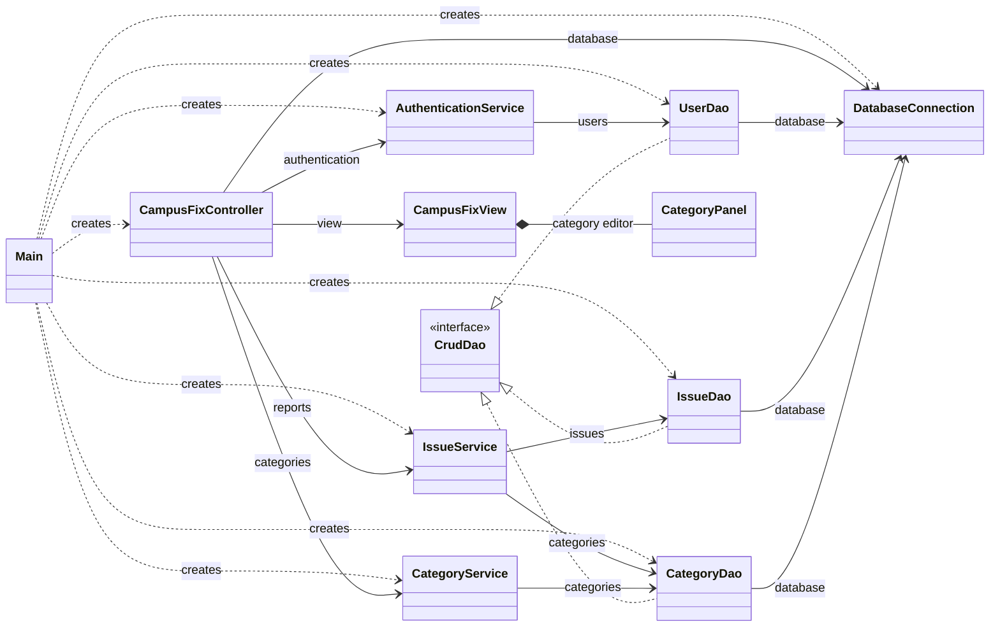

# Python desktop client

The Tkinter client lets regular users submit maintenance reports and review
their own reports. They can edit or cancel a report while it is open.
Administrators can review reports from all users, start work, record resolutions,
and manage report categories.

## Changesets

### Foundation

The Tkinter client checks its connection to PostgreSQL. It reads the root `.env`
with python-dotenv and uses Psycopg to run `SELECT 1`. The window displays the
result and remains responsive while the check runs.

### Account sign-in

The sign-in form accepts a username and password. `UserDao` looks up the username
with a parameterized query and maps the row to a `User` and its credentials.
`AuthenticationService` verifies the password and returns the authenticated `User`
to the Controller. The account screen displays the username and role. Sign-out
clears the user from the Controller and returns to the form.

`UserDao` implements `CrudDao` for creating, reading, updating, and deleting
accounts. Username lookup is specific to `UserDao`.

### Submit and list maintenance reports

Regular users submit a title, location, category, and description. New reports
start in `OPEN`. `IssueService` checks who can submit and selects the report list
for the signed-in role. `IssueDao` and `CategoryDao` implement `CrudDao` and use
parameterized queries to persist reports and categories. The list shows the
reporter and category name alongside each report.

### Edit and cancel open reports

Regular users can edit or cancel their own open reports. Editing uses the same
field validation as submission and requires an active category. Cancellation
sets the report to `CANCELLED` and keeps it visible in report lists.

`IssueService` checks the account role. The update statements check the
reporter and current status in PostgreSQL so an action from an older screen
cannot edit or cancel a report after its status changes.

### Start work and resolve reports

Administrators move a report from `OPEN` to `IN_PROGRESS` with **Start work**.
Once the report is in progress, **Resolve report** moves it to `RESOLVED` with
a required resolution note of up to 2,000 characters. The reporter can read
the note in the report details.

`IssueService` checks the administrator role and validates the note. Each DAO
update checks the report's current status in the same statement that writes
the new status. Resolution saves the status and note together.

### Manage report categories

Administrators can add, rename, deactivate, and reactivate categories.
`CategoryService` checks the administrator role and validates category names.
`CategoryDao` updates the name or active flag by ID. Reports keep their original
category ID and display the current name, including when the category is
inactive. Report forms offer active categories.

## Architecture



The entry point creates a `DatabaseConnection` and passes it to the three DAOs.
The Controller creates the View and binds callbacks for account, report, and
category actions, refresh, and the connection check. The View renders the
forms and lists and forwards actions through those callbacks.

The Controller runs database work on one worker and updates the View on the
Tkinter event thread. The Model opens a connection on first use and reuses it in
autocommit mode. Closing the window lets any ongoing operation finish before the
worker closes the connection. Restart the app if an established connection is
lost.

## Run locally

Use Python 3.10 or newer with Tkinter. Run `python3 -m tkinter` to check that Tk
is available. Some Python distributions package Tkinter separately.

From the repository root, configure `.env` from `.env.example`. With Docker
running, start PostgreSQL and apply the migrations in order.

```sh
docker compose up -d --wait &&
docker compose exec -T database sh -c \
  'psql -v ON_ERROR_STOP=1 -U "$CAMPUSFIX_DB_USER" -d campusfix' \
  < database/002-accounts.sql &&
docker compose exec -T database sh -c \
  'psql -v ON_ERROR_STOP=1 -U "$CAMPUSFIX_DB_USER" -d campusfix' \
  < database/003-maintenance-reports.sql &&
docker compose exec -T database sh -c \
  'psql -v ON_ERROR_STOP=1 -U "$CAMPUSFIX_DB_USER" -d campusfix' \
  < database/004-report-cancellation.sql &&
docker compose exec -T database sh -c \
  'psql -v ON_ERROR_STOP=1 -U "$CAMPUSFIX_DB_USER" -d campusfix' \
  < database/005-report-resolution.sql
```

`003-maintenance-reports.sql` creates the issue and category tables and seeds the
initial categories when the category table is empty. `004-report-cancellation.sql`
allows reports to be marked `CANCELLED`. `005-report-resolution.sql` adds the two
work statuses and the resolution note. The scripts are safe to rerun.

```sh
cd python
python3 -m venv .venv
source .venv/bin/activate
python -m pip install -r requirements.txt
python -m campusfix
```

On Windows, use `py -3` to create the environment and activate it with
`.venv\Scripts\activate` from Command Prompt.

| Username | Password | Role |
| --- | --- | --- |
| `alice` | `alice-demo` | Regular |
| `bob` | `bob-demo` | Regular |
| `admin` | `admin-demo` | Administrator |

These sample accounts are for local development databases. Sign in as
`alice` or `bob` to submit a report under **My reports**. Select an open report
and choose **Edit report** to load it into the form, or choose **Cancel report**
and confirm to mark it `CANCELLED`. Sign in as `admin` to see **All reports**.
Select an open report and choose **Start work**. When the work is complete,
enter a note and choose **Resolve report**.

As `admin`, open **Categories** to add a name or select a category to rename,
deactivate, or reactivate. Use **Reports** to return to the report list.
**Refresh** loads changes to the current list from other sessions.

The connection uses `CAMPUSFIX_DB_URL`, `CAMPUSFIX_DB_USER`, and
`CAMPUSFIX_DB_PASSWORD`. Process environment variables override file settings.
Use the `jdbc:postgresql://` URL from `.env.example`. The Model strips the `jdbc:`
prefix before passing it to Psycopg.

## Verification

With the virtual environment active, run the unit tests from `python/`.

```sh
python -m unittest discover -s tests
```

For the integration tests, set `CAMPUSFIX_TEST_DB_URL` in `.env` to the JDBC URL
for `campusfix_test`. The tests require a separate database whose name ends
in `_test`. With PostgreSQL running, apply the migrations from the repository root.

```sh
docker compose exec -T database sh -c \
  'psql -v ON_ERROR_STOP=1 -U "$CAMPUSFIX_DB_USER" -d campusfix_test' \
  < database/002-accounts.sql &&
docker compose exec -T database sh -c \
  'psql -v ON_ERROR_STOP=1 -U "$CAMPUSFIX_DB_USER" -d campusfix_test' \
  < database/003-maintenance-reports.sql &&
docker compose exec -T database sh -c \
  'psql -v ON_ERROR_STOP=1 -U "$CAMPUSFIX_DB_USER" -d campusfix_test' \
  < database/004-report-cancellation.sql &&
docker compose exec -T database sh -c \
  'psql -v ON_ERROR_STOP=1 -U "$CAMPUSFIX_DB_USER" -d campusfix_test' \
  < database/005-report-resolution.sql
```

Then run the integration suite from `python/` with the virtual environment active.

```sh
python -m unittest discover -s tests/integration
```

The unit tests cover report validation, password checking, and database settings.
The integration tests cover connection handling, account CRUD, sign-in, report
visibility by role, active-category checks, and permissions for edits,
cancellations, administrator status changes, and category management.
