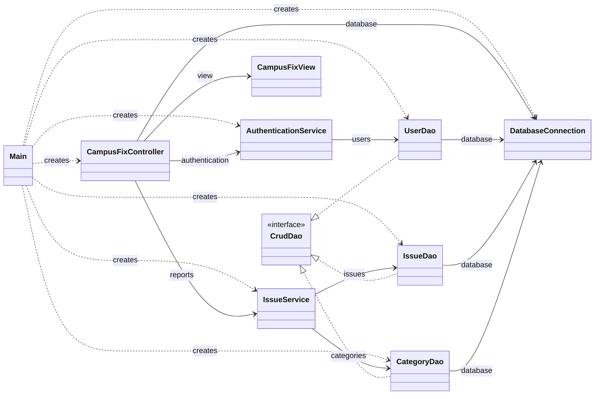

# Python desktop client

The Tkinter client lets regular users submit maintenance reports and review
their own reports. Administrators can review reports from all users.

## Changesets

### Foundation

The Tkinter client checks its connection to PostgreSQL. It reads the root `.env`
with python-dotenv and uses Psycopg to run `SELECT 1`. The window displays the
result and remains responsive while the check runs.

### Account sign-in

The sign-in form accepts a username and password. `UserDao` looks up the username
with a parameterized query and maps the row to a `User` and its credentials.
`AuthenticationService` verifies the password and returns the authenticated `User`
to the Controller. The account screen displays the username and role. Sign-out
clears the user from the Controller and returns to the form.

`UserDao` implements `CrudDao` for creating, reading, updating, and deleting
accounts. Username lookup is specific to `UserDao`.

### Submit and list maintenance reports

Regular users submit a title, location, category, and description. New reports
start in `OPEN`. `IssueService` checks who can submit and selects the report list
for the signed-in role. `IssueDao` and `CategoryDao` implement `CrudDao` and use
parameterized queries to persist reports and categories. The list shows the
reporter and category name alongside each report.

## Architecture



The entry point creates a `DatabaseConnection` and passes it to the three DAOs.
The Controller creates the View and binds callbacks for account actions, report
submission, refresh, and the connection check. The View renders the forms and
report list and forwards actions through those callbacks.

The Controller runs database work on one worker and updates the View on the
Tkinter event thread. The Model opens a connection on first use and reuses it in
autocommit mode. Closing the window lets any ongoing operation finish before the
worker closes the connection. Restart the app if an established connection is
lost.

## Run locally

Use Python 3.10 or newer with Tkinter. Run `python3 -m tkinter` to check that Tk
is available. Some Python distributions package Tkinter separately.

From the repository root, configure `.env` from `.env.example`. With Docker
running, start PostgreSQL and apply the account and maintenance-report migrations.

```sh
docker compose up -d --wait &&
docker compose exec -T database sh -c \
  'psql -v ON_ERROR_STOP=1 -U "$CAMPUSFIX_DB_USER" -d campusfix' \
  < database/002-accounts.sql &&
docker compose exec -T database sh -c \
  'psql -v ON_ERROR_STOP=1 -U "$CAMPUSFIX_DB_USER" -d campusfix' \
  < database/003-maintenance-reports.sql
```

You can rerun both migrations. `003-maintenance-reports.sql` creates the issue
and category tables and seeds the initial categories.

```sh
cd python
python3 -m venv .venv
source .venv/bin/activate
python -m pip install -r requirements.txt
python -m campusfix
```

On Windows, use `py -3` to create the environment and activate it with
`.venv\Scripts\activate` from Command Prompt.

| Username | Password | Role |
| --- | --- | --- |
| `alice` | `alice-demo` | Regular |
| `bob` | `bob-demo` | Regular |
| `admin` | `admin-demo` | Administrator |

These sample accounts are for local development databases. Sign in as
`alice` or `bob` to submit a report under **My reports**. Sign in as `admin` to
see **All reports**. Select a row to read its description and use **Refresh**
to load changes from another session. The sign-in screen offers **Check
database connection**.

The connection uses `CAMPUSFIX_DB_URL`, `CAMPUSFIX_DB_USER`, and
`CAMPUSFIX_DB_PASSWORD`. Process environment variables override file settings.
Use the `jdbc:postgresql://` URL from `.env.example`. The Model strips the `jdbc:`
prefix before passing it to Psycopg.

## Verification

With the virtual environment active, run the unit tests from `python/`.

```sh
python -m unittest discover -s tests
```

For the integration tests, set `CAMPUSFIX_TEST_DB_URL` in `.env` to the JDBC URL
for `campusfix_test`. The tests require a separate database whose name ends
in `_test`. With PostgreSQL running, apply both migrations from the repository root.

```sh
docker compose exec -T database sh -c \
  'psql -v ON_ERROR_STOP=1 -U "$CAMPUSFIX_DB_USER" -d campusfix_test' \
  < database/002-accounts.sql &&
docker compose exec -T database sh -c \
  'psql -v ON_ERROR_STOP=1 -U "$CAMPUSFIX_DB_USER" -d campusfix_test' \
  < database/003-maintenance-reports.sql
```

Then run the integration suite from `python/` with the virtual environment active.

```sh
python -m unittest discover -s tests/integration
```

The unit tests cover report validation, password checking, and database settings.
The integration tests cover connection handling, account CRUD, sign-in, report
visibility by role, and active-category checks.
