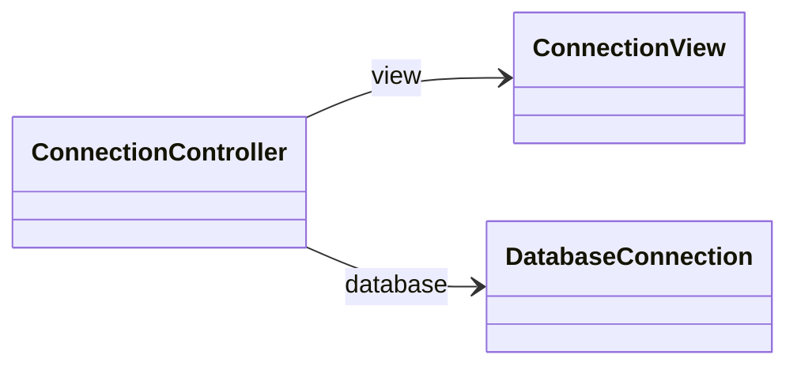

# Python desktop client

## Changesets

### Foundation

The Tkinter client checks its connection to PostgreSQL. It reads the root `.env`
with python-dotenv and uses Psycopg to run `SELECT 1`. The window displays the
result and remains responsive while the check runs.

## Architecture



The entry point creates `DatabaseConnection` and passes it to the Controller.
The Controller creates the View and registers a callback for the check button.
The View renders status and forwards events through the callback. It does not
depend on the Controller or Model classes.

The Controller runs database work on one worker and updates the View on the
Tkinter event thread. The Model opens a connection on first use and reuses it in
autocommit mode. Closing the window lets any ongoing check finish before the
worker closes the connection. Restart the app if an established connection is
lost.

## Run locally

Use Python 3.10 or newer with Tkinter. Run `python3 -m tkinter` to check that Tk
is available. Some Python distributions package Tkinter separately.

If PostgreSQL is not running, configure the root `.env` from `.env.example` and
start it from the repository root with `docker compose up -d --wait`.

```sh
cd python
python3 -m venv .venv
source .venv/bin/activate
python -m pip install -r requirements.txt
python -m campusfix
```

On Windows, use `py -3` to create the environment and activate it with
`.venv\Scripts\activate` from Command Prompt.

Click **Check database connection**. The window should show **Connected to
PostgreSQL.**

The connection uses `CAMPUSFIX_DB_URL`, `CAMPUSFIX_DB_USER`, and
`CAMPUSFIX_DB_PASSWORD`. Process environment variables override file settings.
Use the existing `jdbc:postgresql://` URL from `.env.example`. The Model strips
the `jdbc:` prefix before passing it to Psycopg.

## Verification

From `python/`, with the virtual environment active:

```sh
python -m unittest discover -s tests
python -m unittest discover -s tests/integration
```

The first command checks validation and connection errors without PostgreSQL.
The second runs a real query, verifies autocommit and connection reuse, and
checks cleanup. It uses `CAMPUSFIX_TEST_DB_URL`, which must name a separate
database ending in `_test`.
